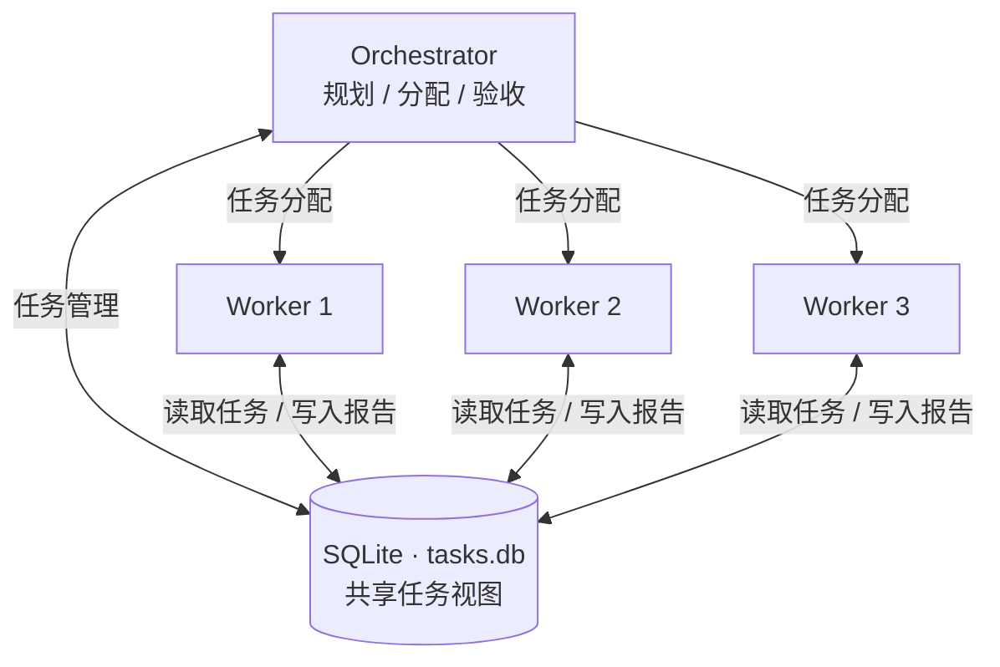

# 注意力是稀缺资源：解读 SuperAgent 哲学与分治架构

**2026 年 11 月 8 日｜第四期**

## 本周专题：SuperAgent 哲学与分治架构

**分享来源：** [Superagent 引入尝试 #12 · 经验分享](https://github.com/Ri0n72Y/rd-dsh-agenda-team/issues/12#issuecomment-6714753624)

DeepSeek 公开了 [dsh-superagent-prototype](https://github.com/deepseek-ai/dsh-superagent-prototype)，一个基于 DeepSeek Harness（DSH）的自主 Agent 研究原型。

其首篇文档 [000 Philosophy](https://github.com/deepseek-ai/dsh-superagent-prototype/blob/main/docs/000-philosophy.md) 提出了一个值得讨论的问题：**当 AI 能够承担越来越多的工作时，如何组织人与 Agent 的协作？**

### 000 Philosophy：人的注意力是一种有限资源

文档开头提出了一项基本原则：

> Take as little human attention as possible, and give as much value as possible.

**尽可能少地占用人的注意力，尽可能多地创造价值。**

每条通知、每次提问、每个配置选项，甚至文档中的每个段落，都在消耗人的注意力。其创造的价值应当超过占用注意力所产生的成本。

这一原则具体体现为五项要求：

1. **行动依据：** Agent 根据明确请求或预先授权的规则开展工作。
2. **沟通时机：** 仅在需要人工决策、产生可用结果或无法继续时发送消息。
3. **提问方式：** 每次提出一个具体、可回答的问题，减少沟通成本。
4. **停止条件：** 根据任务的影响范围、授权和决策权限确定工作边界。
5. **状态真实性：** 明确区分草稿、完成、失败和等待处理，准确报告执行结果。

这些要求同样适用于软件设计：减少配置与界面元素，优先展示需要人工处理的问题，降低日常运行对用户注意力的占用。

过去一段时间，我尝试同时通过多个 AI 对话推进不同项目。

根据个人体验，**目前能够同时关注的上限约为 4 个项目、7 个对话，持续 3～4 小时后会出现明显疲劳。**

注意力主要消耗在项目切换、上下文恢复、进度检查、结果审查和下一步任务安排上。随着 AI 执行效率提高，人工协调任务的频率也随之增加。

这体现了大部分ai使用者与团队的共同需求：将任务组织、进度跟踪和结果检查进一步交给 Agent，使人的注意力进一步解放出来，集中于目标制定、关键决策和成果验收。

### 分治架构：Worker 与 Orchestrator

我们先来做一个简单的架构讨论，做个简陋的原型帮助理解superagent的工作方法。

按照职责范围，可以将 Agent 分为 Worker（执行器）与 Orchestrator（协调器，简称 Orch）。

#### Worker：局部任务的执行者

Worker 接收明确的任务，在独立上下文中完成执行并提交结果。其管理范围包括：

- **任务输入：** 目标、约束、参考材料和验收条件。
- **执行过程：** 选择工具、制定局部步骤、处理执行问题。
- **工作资源：** 当前任务使用的文件、程序和执行环境。
- **执行报告：** 提交成果、验证证据、失败原因和阻塞信息。

Worker 在授权范围内自主执行，任务拆分、跨任务协调和全局状态变更交由 Orch 处理。

#### Orchestrator：全局任务的协调者

Orch 管理任务之间的关系及整体执行过程。

其管理范围包括：

- **任务规划：** 理解需求、拆分任务、确定依赖关系和验收条件。
- **资源调度：** 分配 Worker、管理并发和执行顺序。
- **状态维护：** 跟踪任务进度、执行结果和异常状态。
- **结果验收：** 判断任务是否完成，是否需要重试或返工。
- **人工交互：** 汇总进展、请求必要决策并交付成果。

#### Worker 与 Orch 的交互

两者通过任务分配与执行报告协作：

1. Orch 创建任务，定义执行范围与验收条件。
2. Orch 将任务分配给空闲 Worker。
3. Worker 独立执行，提交结果和状态。
4. Orch 验收结果，决定完成、重试、重新分配或请求人工处理。
5. Orch 根据更新后的任务状态继续调度。

Worker 管理局部执行上下文，Orch 维护全局任务状态。跨 Agent 传递的信息主要包括任务描述、执行状态与成果引用。

#### 最简实现：单 Orch、三 Worker、共享 SQLite

以一个 Orch 调度三个 Worker 为例，四个 Agent 共同使用 SQLite 中的任务视图。

数据库最初只需一张 `tasks` 表：

| 字段 | 用途 |
| --- | --- |
| `id` | 任务标识 |
| `goal` | 任务目标与要求 |
| `status` | Orch 维护的全局状态 |
| `worker_id` | 当前执行者 |
| `worker_status` | Worker 的执行状态 |
| `result_ref` | 执行结果引用 |
| `updated_at` | 最近更新时间 |

调度过程：

**Orch** 从数据库中读取待执行任务，将任务分配给空闲 Worker，并更新任务状态。

**Worker** 读取分配给自己的任务，独立执行，将结果与状态写回 SQLite。

**Orch** 检查 Worker 报告，完成验收并继续分配任务。发生执行中断时，根据任务记录判断是否重新调度。

为避免状态冲突，Orch 负责分配与全局状态更新，Worker 负责自身执行报告。数据库通过事务控制写入，采用 WAL 模式支持并发读写。重新分配任务时，通过执行标识区分新旧报告。

这套最简架构具备三个基本能力：**并行执行、集中调度、任务状态持久化。**

### DeepSeek SuperAgent Prototype 的实现

DeepSeek 的 SuperAgent Prototype 在任务分治的基础上，进一步管理外部事件、任务授权、执行生命周期与消息交付。

主要处理流程：

**Source → Trigger → Eval → Ticket → Assignment → Executor → Report → Channel**

其中，Main Session 主要负责请求路由，Engine 负责领域状态与执行流程，Executor Session 承担具体任务。

| 模块 | 解决的问题 |
| --- | --- |
| **Source / Trigger** | 将 GitHub、飞书等外部事件转换为统一输入。 |
| **Thread / Subscription** | 将后续消息和外部状态变化关联至已有任务。 |
| **Policy / Eval** | 判断请求是否满足授权与执行条件。 |
| **Mandate** | 记录任务的授权依据及执行权限范围。 |
| **Ticket** | 持久化任务生命周期，支持跨 Session 管理。 |
| **Assignment / Executor** | 管理任务分配、独立执行及执行恢复。 |
| **Engine / Store** | 集中管理任务状态变更与数据持久化。 |
| **Effects / Outbox** | 管理外部操作、消息投递、重试与去重。 |
| **Prompts / Skills** | 定义 Agent 行为规范及可复用工作流程。 |
| **Panel** | 展示任务进展及需要人工处理的事项。 |

相较于前文的最简方案，DeepSeek 原型进一步分离了请求路由、授权判断、任务状态和执行生命周期。其中，Engine 承担了大量原本由 Orch 直接处理的状态管理工作。

#### 参考资料

- [DeepSeek SuperAgent Prototype](https://github.com/deepseek-ai/dsh-superagent-prototype)
- [000 Philosophy](https://github.com/deepseek-ai/dsh-superagent-prototype/blob/main/docs/000-philosophy.md)
- [001 Domain Model](https://github.com/deepseek-ai/dsh-superagent-prototype/blob/main/docs/001-domain.md)
- [003 Execution](https://github.com/deepseek-ai/dsh-superagent-prototype/blob/main/docs/003-execution.md)
- [007 Architecture](https://github.com/deepseek-ai/dsh-superagent-prototype/blob/main/docs/007-architecture.md)

## 本周经验分享：将生产流程沉淀为文档

**分享来源：** [Week 4 异步讨论 · 经验分享](https://github.com/Ri0n72Y/rd-dsh-agenda-team/issues/13#issuecomment-6721064154)

最近与朋友讨论 AI Harness 的使用问题：即使已经明确约定工作流程、调用文件和具体操作，AI 在后续执行中仍可能遗忘约定、遗漏步骤或执行错误，需要反复提醒和纠正，产生额外的时间与 Token 成本。

我的建议是：**将确定的生产流程写入固定文档，通常采用 Markdown 格式，让 AI 依据文档执行。**

文档应明确输入、操作步骤、依赖文件、输出和验收标准，并根据实际执行结果持续修订。

验证方法是开启一个全新的 Session，仅提供流程文档及必要输入，检查 AI 能否独立完成预定流程并产生预期结果。执行中需要额外补充的信息，应当进一步写入文档。

这次讨论也让我意识到一种认知差异。

程序员通常习惯将确定、可复用的操作抽象为稳定的功能模块。我在早期使用 AI 时便自然采用了这种方法，却忽略了缺乏编程背景的使用者未必具备相同的思维习惯。

这与认知心理学中的**知识的诅咒（Curse of Knowledge）**有关：掌握某种知识后，人容易低估他人理解和运用这些知识的难度。

### 从可视化流程编排到文本化流程

这种方法与此前流行的**流程编排（Workflow Orchestration）**具有相同的思路。

Dify、Coze、Langflow 等平台通过可视化节点编辑，将 AI 的工作组织为固定流程，明确各步骤的输入、处理逻辑、依赖关系和输出。

随着大模型的指令理解、工具调用和自主规划能力增强，越来越多的流程可以直接通过文本描述，由 Agent 根据文档完成具体操作。

文本化流程允许 AI 根据执行环境灵活选择工具、处理步骤和局部异常。使用者可以直接修改 Markdown 文档来调整流程，减少节点连接、条件分支和中间数据传递等配置工作。

两种方式在执行确定性、可观察性和灵活性上各有适用范围。对于能够由 Agent 自主完成的工作，文本化流程降低了编排和维护成本。

**将流程文档化，通过独立 Session 验证，并根据执行结果持续维护。** 成熟的流程还可以进一步封装为 Skill 或自动化工具。
